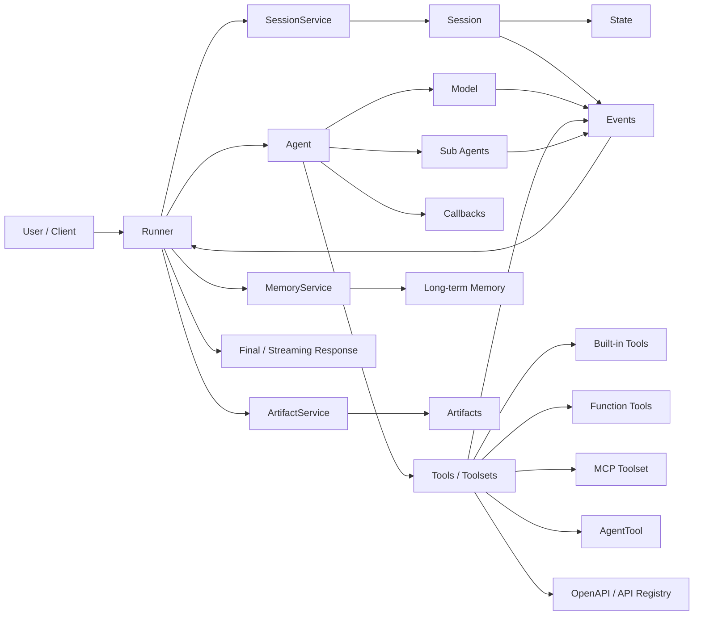

# Google ADK Java Learning Map

> 基于 Google ADK Java 官方 Get Started、ADK Java API Reference、ADK 官方能力文档与 Context7 对 `/google/adk-java`、`/google/adk-docs` 的检索结果整理。  
> 重点面向 Java 学习与工程落地；跨语言文档中已有但 Java API 仍在演进的能力，单独标注为“平台级能力 / 需确认 Java API 成熟度”。

## 0. 总览定位

Google Agent Development Kit, ADK, 是一个 code-first 的 Agent 开发框架，用于构建、调试、评估和部署 AI Agent。Java 版本以 Maven 多模块项目形态提供，核心模块覆盖 Agent 定义、Runner 执行、Session 管理、Tool 调用、事件流、模型适配等能力，并可通过开发服务器进行本地调试。

ADK Java 的核心价值：

- 用 Java 代码直接定义 Agent 行为、工具、编排和运行方式。
- 支持 LLM Agent、Workflow Agent、多 Agent 组合与 Tool 调用。
- 支持会话状态、事件流、Artifact、Memory 等运行时上下文。
- 支持 Google 生态工具与外部模型 / 工具集成。
- 提供评估与部署路径，适合从原型走向生产。

## 1. ADK 能力树

```text
ADK
├─ Agent 构建
│  ├─ LlmAgent
│  ├─ BaseAgent
│  ├─ Workflow Agent
│  │  ├─ SequentialAgent
│  │  ├─ ParallelAgent
│  │  └─ LoopAgent
│  └─ 多 Agent 组合
│     ├─ subAgents
│     ├─ AgentTool
│     └─ transfer / delegation
├─ 模型接入
│  ├─ Gemini / Google GenAI
│  ├─ Vertex AI
│  ├─ LiteLlm / OpenAI 兼容模型
│  └─ LangChain4j 模型适配
├─ Tool 体系
│  ├─ Function Tool
│  ├─ Built-in Tool
│  ├─ Google Search Tool
│  ├─ Agent Tool
│  ├─ Toolset
│  ├─ MCP Toolset
│  └─ OpenAPI / API Registry 工具
├─ Runtime
│  ├─ Runner
│  ├─ Invocation Context
│  ├─ Event
│  ├─ Streaming
│  ├─ Callback
│  └─ Error / Retry / Safety 控制
├─ Session 体系
│  ├─ Session
│  ├─ BaseSessionService
│  ├─ InMemorySessionService
│  ├─ State
│  └─ Event history
├─ Memory 体系
│  ├─ BaseMemoryService
│  ├─ InMemoryMemoryService
│  ├─ long-term memory
│  ├─ search memory
│  └─ Memory MCP Server / 外部存储
├─ Artifact 体系
│  ├─ BaseArtifactService
│  ├─ InMemoryArtifactService
│  └─ 文件、图片、生成物上下文
├─ 评估
│  ├─ Eval case
│  ├─ Response quality
│  ├─ Tool trajectory
│  ├─ Regression test
│  └─ CI / 自动化评估
├─ 调试与开发体验
│  ├─ CLI
│  ├─ adk web / Dev UI
│  ├─ Spring Boot dev server
│  └─ Trace / event inspection
└─ 部署
   ├─ Local run
   ├─ Cloud Run
   ├─ Vertex AI Agent Engine
   ├─ GKE / 自托管
   └─ 企业集成与观测
```

## 2. ADK 核心概念图



核心关系：

- `Runner` 是运行入口，负责把用户消息、Session、Agent、Tool、Artifact、Memory 串起来。
- `Agent` 是行为定义单元，可以是 LLM 驱动，也可以是确定性 Workflow。
- `Session` 保存一次用户 / 应用上下文中的状态与事件历史。
- `Memory` 面向跨 Session 的长期记忆和检索。
- `Tool` 是 Agent 与外部世界交互的接口。
- `Event` 是运行过程的事实记录，包含模型输出、工具调用、工具结果、状态变化等。

## 3. Java API 分类

### 3.1 Agent API

主要包：`com.google.adk.agents`

- `BaseAgent`：Agent 抽象基类，定义 Agent 的基础生命周期与运行契约。
- `LlmAgent`：Java ADK 的主要 Agent 类型，用 LLM 指令、模型和工具完成任务。
- `SequentialAgent`：按顺序执行子 Agent。
- `ParallelAgent`：并行执行多个子 Agent。
- `LoopAgent`：循环执行子 Agent，直到满足停止条件或达到限制。
- Agent Builder：以 builder 方式配置名称、描述、模型、指令、工具、子 Agent 等。

### 3.2 Runner / Runtime API

主要包：`com.google.adk.runner`、`com.google.adk.events`、`com.google.adk.invocation`

- `Runner`：Agent 执行器，负责接收用户消息并生成事件流 / 响应。
- `InvocationContext`：单次调用上下文，包含 Session、Agent、服务实例、状态等。
- `Event`：运行过程事件，是调试、评估、状态更新的重要载体。
- Streaming 相关 API：支持逐步返回模型输出、工具调用过程和最终响应。

### 3.3 Model API

主要包：`com.google.adk.models`

- Google / Gemini 模型接入。
- Vertex AI 模型接入。
- LiteLlm / OpenAI 兼容模型接入。
- LangChain4j adapter：通过 `com.google.adk.models.langchain4j` 适配 LangChain4j chat model。

### 3.4 Tool API

主要包：`com.google.adk.tools`

- `BaseTool`：工具抽象。
- `FunctionTool`：把 Java 方法 / 函数暴露为 Agent 可调用工具。
- `GoogleSearchTool`：内置 Google Search 工具。
- `AgentTool`：把一个 Agent 包装成另一个 Agent 可调用的工具。
- Toolset：一组工具的集合，常用于 MCP、OpenAPI 或外部 API。
- Tool context：工具执行时访问会话、状态、调用上下文的入口。

### 3.5 Session API

主要包：`com.google.adk.sessions`

- `Session`：保存 app、user、session id、state、events 等信息。
- `BaseSessionService`：Session 持久化和查询的抽象接口。
- `InMemorySessionService`：内存实现，适合本地学习、原型和测试。
- 生产环境通常需要持久化实现，例如数据库、Redis、云服务或自定义实现。

### 3.6 Memory API

主要包：`com.google.adk.memory`

- `BaseMemoryService`：长期记忆服务抽象。
- `InMemoryMemoryService`：内存记忆实现。
- Memory 查询 / 写入：用于跨 Session 保存用户偏好、事实、摘要等长期上下文。
- Memory MCP Server：平台级文档中提供通过 MCP 暴露长期记忆工具的路径。

### 3.7 Artifact API

主要包：`com.google.adk.artifacts`

- `BaseArtifactService`：Artifact 服务抽象。
- `InMemoryArtifactService`：内存实现。
- 用于保存 Agent 运行中生成或引用的文件、图片、结构化产物等。

### 3.8 Evaluation / Deployment API

- Evaluation：官方文档支持用 eval cases 验证响应质量、工具轨迹和回归行为；Java 项目应结合 ADK 评估能力与 JUnit / CI 落地。
- Deployment：官方文档支持 Cloud Run、Vertex AI Agent Engine、自托管等路径；Java 生产部署需结合 Spring Boot / Maven / 容器化形态设计。

## 4. Agent 类型

### 4.1 LlmAgent

最常用的 Agent 类型。它由模型、系统指令、工具、子 Agent、回调与执行配置组成，适合问答、工具调用、推理、规划和多轮交互。

适用场景：

- 通用助手。
- 搜索增强助手。
- API 操作助手。
- 需要 Tool calling 的业务 Agent。
- 多 Agent 系统中的主控 Agent。

### 4.2 Workflow Agent

Workflow Agent 不主要依赖 LLM 自主决定流程，而是用固定结构组织子 Agent。

类型：

- `SequentialAgent`：适合线性流程，例如“需求分析 -> 检索 -> 总结 -> 校验”。
- `ParallelAgent`：适合并行分工，例如多个资料源同时分析。
- `LoopAgent`：适合迭代式任务，例如反复生成和检查直到通过。

### 4.3 Multi-Agent

ADK 支持把多个 Agent 组合成系统：

- 父 Agent 管理多个 `subAgents`。
- 一个 Agent 可以通过 `AgentTool` 被另一个 Agent 调用。
- 可以设计 coordinator、specialist、critic、executor 等角色。
- 可以用 Workflow Agent 固定编排，也可以让 LLM Agent 动态委派。

### 4.4 Custom Agent

通过继承或实现基础 Agent 契约，可以构建自定义 Agent。

适用场景：

- 需要确定性业务流程。
- 需要特殊生命周期控制。
- 需要深度集成企业系统。
- 需要绕开通用 LLM Agent 的决策方式。

## 5. Tool 类型

### 5.1 Function Tool

把 Java 方法暴露给 Agent 调用。适合封装业务查询、计算、数据库访问、内部服务调用等。

学习重点：

- 工具名称与描述必须清晰。
- 参数 schema 要稳定、可解释。
- 工具应保持单一职责。
- 工具返回值应结构化，便于模型继续推理。

### 5.2 Built-in Tool

ADK 提供部分内置工具，例如 Google Search。适合快速构建具备外部信息访问能力的 Agent。

注意：

- 内置工具通常依赖模型和平台能力。
- 不同模型、不同运行环境可用性可能不同。
- 生产环境要明确权限、费用和数据边界。

### 5.3 Agent Tool

把 Agent 作为 Tool 暴露给另一个 Agent。它是多 Agent 设计的关键机制。

适用场景：

- 专家 Agent：法律、财务、代码、检索等。
- 子任务 Agent：摘要、分类、转换、校验。
- 管理型 Agent：主控 Agent 根据任务调用不同 AgentTool。

### 5.4 MCP Toolset

通过 Model Context Protocol 接入外部工具服务器。

常见连接模式：

- stdio：本地启动 MCP server。
- SSE：连接远程 MCP server。
- Streamable HTTP：平台级文档中用于远程 MCP 服务。

适用场景：

- 文件系统工具。
- 企业知识库。
- Google Developer Knowledge。
- API Registry。
- 长期记忆 MCP Server。
- 第三方 MCP 生态工具。

### 5.5 OpenAPI / API Registry Tool

通过 OpenAPI 或 API Registry 把外部 API 转成 Agent 可调用工具。

适用场景：

- 企业已有 REST API。
- Google Cloud API。
- BigQuery、数据平台、内部业务系统。

## 6. Workflow 类型

### 6.1 Sequential Workflow

按顺序执行多个 Agent 或步骤。

适合：

- 信息收集后再生成。
- 生成后再审查。
- 多阶段业务流程。

设计要点：

- 每一步输入输出要清晰。
- 中间状态应写入 Session state 或 Artifact。
- 每个子 Agent 的职责要小而明确。

### 6.2 Parallel Workflow

同时运行多个子 Agent，再汇总结果。

适合：

- 多来源检索。
- 多角度分析。
- 多模型 / 多策略比较。

设计要点：

- 明确结果合并策略。
- 避免多个并行步骤写同一状态键。
- 汇总 Agent 需要能识别冲突和不确定性。

### 6.3 Loop Workflow

重复执行某个流程直到满足条件。

适合：

- 草稿 -> 批改 -> 修改。
- 计划 -> 执行 -> 评估。
- 生成 -> 测试 -> 修复。

设计要点：

- 必须有最大迭代次数。
- 必须有停止条件。
- 每轮输出要可比较。

## 7. Memory 体系

### 7.1 Memory 与 Session 的区别

```text
Session = 当前会话上下文
Memory  = 跨会话长期知识
```

Session 保存当前对话和短期状态；Memory 保存跨 Session 的用户偏好、事实、摘要和可检索知识。

### 7.2 Memory 组成

- `BaseMemoryService`：长期记忆抽象。
- `InMemoryMemoryService`：本地内存实现。
- Memory entries：可被检索的事实或摘要。
- Search memory：根据当前问题检索相关长期记忆。
- Memory tools：通过工具方式让 Agent 主动创建、查询和使用记忆。

### 7.3 Memory 使用策略

初级：

- 先理解 Session state，不急于引入长期记忆。

中级：

- 保存用户偏好、项目背景、固定事实。
- 用检索结果补充 Agent 指令上下文。

高级：

- 对对话做摘要后写入 Memory。
- 区分用户事实、任务事实、系统事实。
- 引入过期、冲突解决和隐私删除机制。

生产级：

- 持久化 Memory。
- 权限隔离到 app / tenant / user。
- 记录 Memory 来源和更新时间。
- 支持审计、删除、脱敏和合规。

## 8. Session 体系

### 8.1 Session 角色

Session 是 ADK 运行时的核心上下文，通常包含：

- `appName`
- `userId`
- `sessionId`
- `state`
- `events`
- 当前对话历史

### 8.2 SessionService

- `BaseSessionService` 定义 Session 创建、读取、更新、事件追加等能力。
- `InMemorySessionService` 用于本地开发和测试。
- 生产环境应使用持久化 SessionService。

### 8.3 State

State 是 Agent / Tool / Workflow 共享的结构化状态。

常见用途：

- 保存用户当前任务参数。
- 保存 Workflow 中间结果。
- 保存工具调用结果摘要。
- 控制下一步路由或停止条件。

### 8.4 Event History

Event 记录 Agent 运行过程：

- 用户消息。
- 模型响应。
- 工具调用请求。
- 工具执行结果。
- 状态变化。
- 最终响应。

用途：

- 调试。
- 回放。
- 评估。
- 审计。
- 用户体验中的流式展示。

## 9. MCP 支持

### 9.1 MCP 的作用

MCP 用统一协议把外部工具、数据源和服务暴露给 Agent。ADK 通过 MCP Toolset 把这些工具接入 Agent 的 Tool 体系。

### 9.2 支持形态

官方 ADK 文档覆盖：

- stdio MCP server。
- SSE MCP server。
- Streamable HTTP MCP server。
- tool filter。
- MCP server lifecycle / close。
- Memory MCP server。
- API Registry MCP server。
- Google Developer Knowledge MCP server。

### 9.3 Java 学习重点

- 理解 `McpToolset` 如何变成 Agent tools。
- 理解连接参数、工具过滤和生命周期。
- 区分本地 stdio 工具和远程 MCP 服务。
- 生产环境关注鉴权、超时、重试、审计和工具权限。

### 9.4 典型应用

- 连接本地文件系统 MCP。
- 连接公司内部知识库 MCP。
- 连接数据库 / BigQuery MCP。
- 连接长期记忆 MCP。
- 把已有后端接口包装成 MCP server，再由 ADK Agent 调用。

## 10. Evaluation 支持

### 10.1 Evaluation 的目标

ADK Evaluation 用来验证 Agent 是否稳定、正确、可回归。

主要评估维度：

- 最终回答质量。
- 是否调用了正确工具。
- 工具调用参数是否正确。
- 多轮对话状态是否正确。
- Workflow 是否按预期执行。
- 回归测试是否稳定。

### 10.2 Evaluation 组成

- Eval case：输入、期望输出、期望工具轨迹。
- Eval dataset：多个 eval case 的集合。
- Scoring：对响应质量、工具调用、轨迹进行评分。
- Regression：在代码、模型、提示词、工具变更后重复运行。

### 10.3 Java 落地建议

- 用 ADK 官方 eval 能力管理 Agent 行为案例。
- 用 JUnit 覆盖纯 Java 工具逻辑。
- 用 CI 固定运行关键 eval cases。
- 对非确定性模型输出采用语义评分和轨迹评分结合。
- 对生产关键路径设置最小通过阈值。

## 11. Deployment 支持

### 11.1 部署目标

ADK 官方文档覆盖从本地运行到云端生产部署的路径。Java 项目通常需要结合 Maven、Spring Boot、容器和云平台完成部署。

### 11.2 部署形态

- Local：本地 Runner / dev server，用于开发调试。
- Cloud Run：容器化部署，适合 HTTP 服务型 Agent。
- Vertex AI Agent Engine：Google Cloud 上的 Agent 托管运行环境。
- GKE / 自托管：适合复杂企业网络、私有依赖和高控制要求。
- CI/CD：构建、测试、评估、镜像发布、部署。

### 11.3 生产关注点

- 模型凭证与密钥管理。
- Tool 权限隔离。
- Session / Memory 持久化。
- 速率限制与成本控制。
- 日志、Trace、Metrics。
- 安全审计。
- 数据脱敏。
- Evaluation gate。
- 灰度发布与回滚。

## 12. 四阶段学习路线

## 初级：能跑通一个 Java LLM Agent

目标：

- 理解 ADK 是什么。
- 能读懂 Java quickstart。
- 能创建一个基础 `LlmAgent`。
- 能理解 Runner、Session、Event 的关系。

学习内容：

- ADK Java 项目结构。
- Maven 依赖与环境变量。
- `LlmAgent` 的 name、description、model、instruction。
- `Runner` 的职责。
- `InMemorySessionService`。
- 基础事件流。
- Google Search Tool 的使用场景。

产出能力：

- 能解释“用户消息如何经过 Runner 到 Agent 再返回响应”。
- 能区分 Agent、Model、Tool、Session。
- 能用内存 Session 做本地测试。

建议阅读顺序：

1. Java Get Started。
2. Java API Reference: agents。
3. Java API Reference: runner / sessions / events。
4. Tools: Google Search / Function Tool。

## 中级：能构建可用的 Tool-Using Agent

目标：

- 掌握工具设计。
- 掌握 Session state。
- 能构建带业务工具的 Agent。
- 能处理多轮上下文和状态。

学习内容：

- `FunctionTool`。
- `BaseTool`。
- Tool 参数和返回值设计。
- Tool context。
- Session state 读写。
- Artifact 基础。
- Streaming 基础。
- Agent callback 基础。

产出能力：

- 能把后端查询能力封装成 Tool。
- 能让 Agent 在多轮对话中保留任务状态。
- 能通过 Event 调试工具调用链路。
- 能设计清晰的工具描述和参数 schema。

建议阅读顺序：

1. Java API Reference: tools。
2. Java API Reference: sessions。
3. Java API Reference: artifacts。
4. Streaming Java 文档。
5. Callback / runtime 相关文档。

## 高级：能设计多 Agent 和 Workflow

目标：

- 掌握多 Agent 组合。
- 掌握 Workflow Agent。
- 掌握 MCP 接入。
- 掌握 Memory 设计。

学习内容：

- `SequentialAgent`。
- `ParallelAgent`。
- `LoopAgent`。
- `AgentTool`。
- `subAgents`。
- MCP Toolset。
- OpenAPI / API Registry。
- `BaseMemoryService` 与长期记忆。
- 自定义 SessionService / MemoryService 思路。

产出能力：

- 能设计 coordinator + specialist 多 Agent 架构。
- 能用顺序、并行、循环编排复杂任务。
- 能把外部 MCP server 接入 Agent。
- 能区分短期状态、长期记忆和 Artifact。
- 能为 Agent 系统设计可测试的中间状态。

建议阅读顺序：

1. Workflow Agents。
2. Multi-agent systems。
3. AgentTool。
4. MCP Tools。
5. Memory 文档。
6. OpenAPI / API Registry 集成。

## 生产级：能评估、部署和治理 Agent 系统

目标：

- 能把 Java ADK Agent 放入生产服务。
- 能建立评估体系。
- 能治理安全、成本、权限和可观测性。

学习内容：

- Evaluation cases。
- Tool trajectory 评估。
- Regression eval。
- Cloud Run / Vertex AI Agent Engine。
- Session 持久化。
- Memory 持久化。
- Secret management。
- IAM / 权限边界。
- 日志、Trace、Metrics。
- Rate limit、timeout、retry。
- 数据安全与合规。

产出能力：

- 能设计 Agent 生产架构。
- 能把 eval 放进 CI/CD。
- 能对工具调用做审计。
- 能处理模型升级和提示词变更带来的回归风险。
- 能设计灰度、回滚和成本控制策略。

建议阅读顺序：

1. Evaluation。
2. Deployment。
3. Observability / tracing。
4. Sessions and Memory production storage。
5. MCP security。
6. Cloud Run / Vertex AI Agent Engine。

## 13. 推荐知识检查清单

初级完成后应能回答：

- `Runner` 和 `LlmAgent` 分别负责什么？
- `Session` 为什么不是 Memory？
- `Event` 在调试中有什么作用？
- Tool calling 的基本流程是什么？

中级完成后应能回答：

- 一个好的 Tool 描述应该包含什么？
- Tool 返回值为什么要结构化？
- Session state 应该保存什么，不应该保存什么？
- Streaming 中哪些事件适合展示给用户？

高级完成后应能回答：

- 什么时候用 `SequentialAgent`，什么时候用 `ParallelAgent`？
- `AgentTool` 和 `subAgents` 的区别是什么？
- MCP server 的鉴权和权限边界如何设计？
- Memory 写入需要哪些防误记机制？

生产级完成后应能回答：

- 如何评估一次 Agent 改动是否可上线？
- 如何限制工具调用权限？
- 如何审计某次错误回答的完整链路？
- 如何控制模型成本和工具调用成本？
- 如何删除用户长期记忆并证明已删除？

## 14. 学习路线总表

| 阶段 | 核心主题 | 关键 API / 能力 | 最终能力 |
| --- | --- | --- | --- |
| 初级 | 单 Agent、基础运行 | `LlmAgent`, `Runner`, `Session`, `Event` | 跑通并解释基础 Agent |
| 中级 | 工具与状态 | `FunctionTool`, `BaseTool`, `Session state`, `Artifact`, Streaming | 构建业务工具 Agent |
| 高级 | 多 Agent 与外部集成 | `SequentialAgent`, `ParallelAgent`, `LoopAgent`, `AgentTool`, `MCP`, `Memory` | 设计复杂 Agent 系统 |
| 生产级 | 评估与部署治理 | Evaluation, Deployment, persistent Session / Memory, observability | 生产化 Agent 平台 |

## 15. 后续深入方向

- Java API Reference 逐包阅读：agents -> runner -> tools -> sessions -> memory -> artifacts -> models。
- 用官方 examples 对照概念，但学习笔记中避免只背代码。
- 为每个 Tool 编写“职责、输入、输出、失败模式、权限边界”说明。
- 为每个 Agent 编写“目标、可用工具、状态依赖、评估用例”说明。
- 生产前建立 eval dataset，并把工具轨迹作为核心验收标准。
